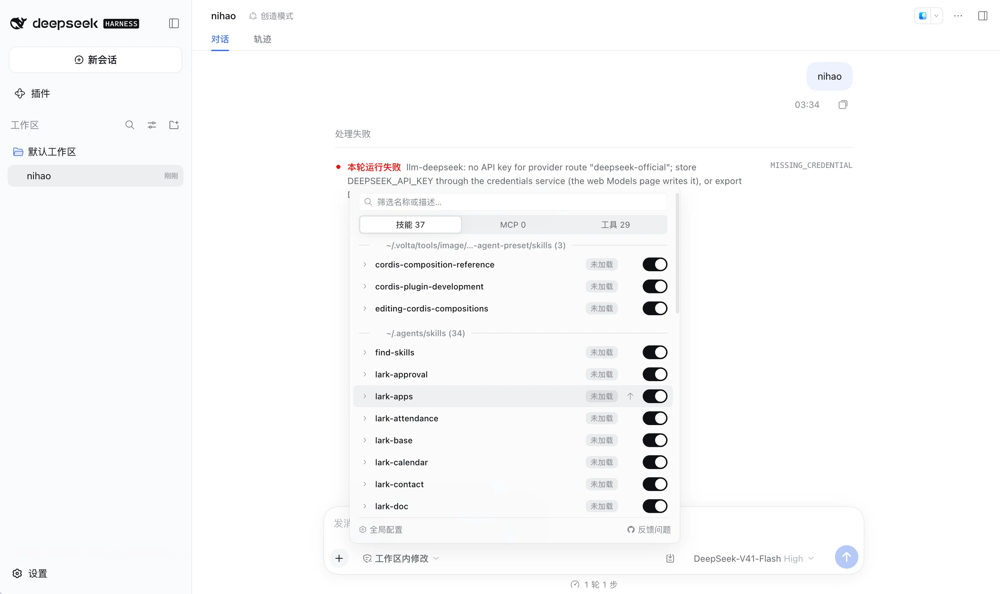
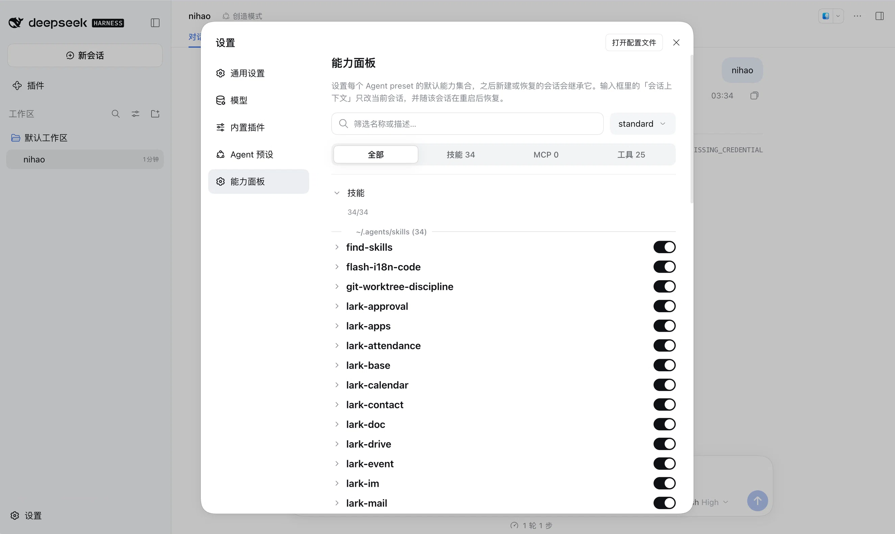

# dsh-capability-panel

[](https://www.npmjs.com/package/dsh-capability-panel) [](https://github.com/pure-craft/dsh-capability-panel/actions/workflows/check.yml) [](LICENSE)


[English](README.en.md) | [中文](README.md) | 日本語 | [한국어](README.ko.md)

**MCP サーバー・スキル(Skills)・ツール(Tools)を一元管理するパネル:DeepSeek Harness エージェントが今まさに到達できるものを可視化し、セッション単位・プリセット単位で切り替える。**

スキル & MCP 管理パネル:すべてのスキル・MCP サーバー・システムツールについて、実際にコンテキスト内にあるかどうかの状態と、次のモデルステップから即座に効くスイッチを備えます。



---

## 速見(エージェント向けクイックリファレンス)

| | |
|---|---|
| 概要 | [DeepSeek Harness](https://github.com/deepseek-ai/deepseek-harness)(`dsh`)の web プラグイン。スキル & MCP 管理パネルとして、現在のセッションのスキル(skills)・MCP サーバー(MCP servers)・システムツール(tools)と、その真のコンテキスト内状態を一覧し、個別に切り替える |
| 用途 | 「なぜエージェントはこのスキルを知らないのか」の解明。ロード済みスキルがプルーニング/コンパクションを生き残ったかの確認。特定のツールや MCP サーバーをこのセッションだけで無効化。プリセットごとのデフォルト能力セットの設定。無効化後にブロックされた呼び出し回数の計測 |
| インストール | `dsh plugin --profile web add dsh-capability-panel`(その後 dsh を再起動) |
| 要件 | dsh web プロファイル、dsh ≥ 0.1.2-alpha.4(それ以前でも動作しますが、ロード状態は degraded 表示。0.1.7 以降ではホスト API の変更に伴いプリセットフォルダを開く機能は利用不可)。`@deepseek-ai/*` の peer はすべてホストが提供 |
| データ | 設定セクション: dsh 0.1.7+ ではアクティブな profile パッチ内の本プラグインエントリ自身の Config(エントリ id でアドレス)、≤ 0.1.6 では `$DSH_HOME/settings.yaml` の `capability-panel` 名前空間。統計は `$DSH_HOME/capability-panel/stats.jsonl`。loopback API `/api/capability-panel` |
| パッケージ | npm の `dsh-capability-panel`。bundle id は `capability-panel` |

## なぜ

スキルが*インストールされている*ことと、*今モデルのコンテキストに入っている*ことは別の事実です——そして「なぜエージェントがこれを知らないのか」に答えるのは後者だけです。その間にはコンテキスト管理が挟まります:ツール結果プルーナーは長いペイロードを切り詰め、コンパクションは歴史の区間を要約に置き換えます。5 分前にロードされたスキルは、モデルの視野から部分的にも完全にも消えているかもしれません。

また、ある会話でモデルに特定のツールを使わせたくないだけ、ということもあります——プラグインをアンインストールするのではなく、設定ファイルを編集して再起動するのでもなく。ただこのセッションで、次のステップから。

## 機能:スキル・MCP・ツール管理

- **正確なロード状態。** 各スキルは、モデルが次のリクエストで実際に見るものを報告します:`loaded`(完全な指示がコンテキスト内)/ `truncated`(プルーナーが首尾を残し中間を削除)/ `evicted`(コンパクションが完全に除去)/ `not loaded`。累計ロード回数付きで、除去後に再ロードされたスキルは `loaded ×2` と読めます。
- **再起動しても消えないセッション単位のスイッチ。** 現在の会話でスキル・ツール・MCP サーバーまるごとをオフに。次のプロンプト組み立てから適用され、dsh の再起動後もそのセッションに紐づいたまま復元されます。他のセッションや会話履歴には一切触れません。
- **プリセットのデフォルト。** 設定 → 能力パネル で、エージェントプリセットごとのデフォルト能力セットを保存。以後に作成・復元されるセッションがそれを継承します。ホスト内蔵プラグインページと同じカード操作(カード上部全体で展開、フッターに常駐するスイッチ)、全部 / スキル / MCP / ツールのカテゴリ切り替え、ソース別グループを備え、プリセットのデフォルトはあくまで起点で、セッション内で上書きできます。
- **MCP をサーバーごとにグループ化。** 2 つのサーバーに 200 個のツールがあっても見通せます。サーバーごと 1 行に畳み、1 回の書き込みで全体を切り替え。
- **オフラインのサーバーも一覧に残る。** ホスト構成で宣言されているのに現在ツールを 1 つも登録していない MCP サーバー(起動していないローカルのオンデマンドサービスなど)も行が残ります——「登録ツールなし」と正直に表示し、保存済みのオフ項目を列挙し、今すぐ接続をやり直す「リロード」ボタン付き。セッション途中で登録されたツールにも保存済みのデフォルトが自動で適用されます。
- **ソースごとにグループ化。** スキルと MCP サーバーはラベル付きの区切り線の下にまとまります:プリセット同梱のエントリーは出自のプリセット名を表示し、それ以外は実際のディレクトリ(`~/.dsh/skills`、プロジェクト相対パス、長い場合は中間を省略)を表示——「このスキルはどこから来たのか」が一目でわかります。
- **ワンクリックでソースフォルダへ。** グループの区切り線にホバーするとフォルダアイコンが現れ、クリックするとそのソースディレクトリをシステムのファイルマネージャーで開きます(macOS、Windows、freedesktop Linux)。
- **ブロック回数。** オフにした後もモデルがその能力を呼び続けた場合、パネルがカウントします——モデルが記憶から行動しているシグナルです。
- **ワンクリックでコマンド入力。** スキル行の紙飛行機ボタンが `/skill-name` を入力欄に入れます。あなたの Enter を待つだけです。
- **高速フィルタ。** 名前・説明・状態ラベルで絞り込めます("truncated" や "已截断" でも可)。ヒットした説明は自動展開。

## ツールインサイト（MVP）

- **独立した入口。** 会話入力欄の「ツールインサイト」は現在のワークスペースを初期表示し、**左ナビゲーション → ツールインサイト**はセッションなしでグローバル表示を開きます。ワークスペース／グローバル、preset 視点、ツール／Skills を切り替えられます。初期順序は未使用優先で、使用回数ランキングには小さな棒グラフが付きます。日別トレンドはありません。
- **統計範囲とスイッチ範囲は別です。** インサイトのスイッチは既存のセッション能力操作を再利用し、現在のセッションの今後の呼び出しだけに作用します。preset やグローバルの能力設定は変更しません。特定の preset フィルタは記録済み使用状況の読み取り専用表示となり、別 preset の統計を現在のセッションの能力一覧と誤認しません。セッションがなければ能力を無効化できず、自動無効化も行いません。
- **記録なしはゼロではありません。** 観測済み記録だけを集計します。履歴のカバレッジが不完全ならデータ不足を表示し、記録のない能力を未使用と断定しません。永続化された履歴インデックスは使用回数の下限（lower bound）です。ホスト再起動後はログを再検証してから完全なカバレッジと判断するため、一度も使っていないという証明にはなりません。
- **履歴の取り込みは手動。** 履歴インデックス作成ボタンで、1 バッチあたり最大 2000 イベント、20 セッションを処理し、残りのセッション数を表示します。必要なら再度クリックして続行します。ページを開くだけで履歴全体を自動走査することはありません。
- **入口だけを非表示にできます。** インサイト入口の表示スイッチは会話の入口の表示だけを変更し、使用統計の収集には影響しません。非表示にしても左ナビゲーションからアクセスできます。

## プロダクション品質

- **充実したテスト**: 580+ のテスト。typecheck・型認識 lint・100% カバレッジゲート(ステートメント/分岐/関数/行)を CI で push と PR のたびに強制。
- **失敗をごまかさない**: いずれかの読み取り(スキルレジストリ、セッションビュー、設定ストア)が失敗しても、パネルは部分データと明確なデグレード通知を表示——読み取り失敗を空リストに見せかけません。
- **書き込み競合なし**: プリセットのデフォルトとセッションスイッチは 1 つの直列化書き込みキューを共有し、2 つのパネルが同時に書いても互いを上書きしません。
- **ホストの足を引っ張らない**: agent 作成リスナーは完全に失敗を隔離——プラグインのどんな例外もセッション開始を止めません。
- **ローカルファースト、ネットワーク不要**: データルートは loopback のみを受け付け、プラグインは外部呼び出し・テレメトリ・サードパーティサービスを一切使いません——設定と統計はすべてローカルの `$DSH_HOME` に留まります(「データの保存場所」参照)。
- **巨大なセッションでも瞬時に開く**: 6 万イベント・数十 MB のログを持つセッションでも、パネルは即座に開きます——ゼロコピーの surface 読み取り、開いたときの 1 回だけ、ポーリングもバックグラウンド処理もなし。
- **履歴を保全するスイッチ**: スイッチは会話履歴を決して書き換えません——無効化された能力はログにそのまま残り、「これらはオフ」のノートは組み立てごとに再計算されます。すべてのスイッチは元に戻せる決定であり、不可逆な手術ではありません。
- **公式の拡張ポイントのみ**: すべての能力は dsh の正式な接缝(`tools.restrict`、`system-prompt/assemble`、settings 名前空間、UI slots)から来ており、モンキーパッチはなし——ホストのアップグレードで壊れにくい構造です。
- **テーマはタダ**: 色はすべてホストの design token、アイコン・スイッチ・セグメントコントロールはホストのコンポーネント——ライト/ダークや言語切り替えはホストに自動追従し、テーマコードの保守は不要です。
- **i18n フレンドリー**: パネル文言はホストの UI 言語(中国語/英語)に追従し、ドキュメントは 4 言語で章立てを揃えています。

## インストール

```bash
dsh plugin --profile web add dsh-capability-panel
# または
dsh plugin --profile web add github:pure-craft/dsh-capability-panel
```

インストール後は dsh の再起動が必要です。

DeepSeek Harness の web プロファイル(`dsh web`)、dsh ≥ 0.1.2-alpha.4 が必要です(それ以前のバージョンでもロード状態は degraded 表示で動作します)。1 つのビルドで最新の 0.1.7 まで対応。新ロースターがパスを持たないため「プリセット名からフォルダを開く」機能のみ 0.1.7+ で利用不可で、他の機能は完全に維持されます。`@deepseek-ai/*` の peer はすべてホストが提供するため、他にインストールするものはありません。

**事前設定不要**——会話のインサイト入口はインサイトページで個別に非表示にできます。再起動後、次の場所からアクセスできます:

- 会話の入力欄右側にある**パネルアイコン**——セッションパネルを開きます
- **設定 → 能力パネル**——プリセットごとのデフォルト能力

`--profile web` は `dsh web` GUI が使うプロファイルなので、そのまま実行できます。マーケットプレイスで "capability panel" を検索してワンクリックで入れることもできます。アンインストールは `dsh plugin --profile web remove dsh-capability-panel`。設定と統計は `$DSH_HOME` に残ります("データの保存場所"参照)。

## 使い方

会話を開き、入力欄右側のパネルアイコンをクリックすると、パネルが上に開きます。

- 上部の 3 つのタブ:**Skills N** / **MCP N** / **Tools N**
- 各行右側のスイッチは即時反映——リフレッシュも再起動も不要
- 行をクリックすると説明を展開
- 上部のフィルタは名前・説明・状態ラベルを検索
- 区切り線は各タブをソースごとにグループ化します:プリセット同梱のエントリーはプリセット名、それ以外はディスク上のディレクトリ——区切り線にホバーするとフルパスを表示し、クリックするとそのフォルダをファイルマネージャーで開きます
- オフにした行は淡色表示になり、モデルのシステムプロンプトにも「オフにした能力」が明示されます
- 下部の固定フッターバー:「フィードバック」で issue ページを開きます

`run_code` は予約された Code Mode トランスポートで、レジストリがマスクを禁止しているため、スイッチはオンのまま固定です。

2 つのスコープ、同じスイッチ:**入力欄のパネル**は目の前のセッションに紐づき(再起動後もそのセッションと共に復元)、**設定 → 能力パネル**は以後のすべてのセッションの起点を決めます。



## 仕組み

**構造的に軽量。** プラグインはランタイム依存を一切持たず——React・UI プリミティブ・すべての `@deepseek-ai/*` はホストが提供——読み取りもゼロコピーです。ロード状態は live セッションのインメモリ surface(モデルが次に見るもの)から来ており、永続ログを毎回折り畳み直すことはありません。

スイッチは次のプロンプト組み立てへの薄いオーバーレイ(スキルは同名シャドウ、ツールはレジストリマスク)と、組み立てごとに再計算される告知ノートだけです。セッションの切り替えはセッション自身の id でプラグインの設定名前空間に保存されるため、復元されたセッションは自分のスイッチだけを正確に取り戻し、会話ログには何も書き込まれません。

## データの保存場所

- プリセットのデフォルトとセッション単位のスイッチ位置: dsh 0.1.7+ ではアクティブな profile パッチ(`~/.dsh/profiles/<profile>/cordis.patch.yml`、エントリ id でアドレス)内の本プラグインエントリ自身の Config。dsh ≤ 0.1.6 では `$DSH_HOME/settings.yaml` の `capability-panel` 名前空間。セッション単位のスイッチは `sessions.<sessionId>` 配下、最大 200 セッション、古いものから eviction。ハーネスはロードされていないプラグインのセクションを決して削除しないため、アンインストール後も残ります。
- ブロック統計:`$DSH_HOME/capability-panel/stats.jsonl`。`curl 'http://127.0.0.1:3080/api/capability-panel/stats'` で直接読めます。

データルートは loopback 呼び出しのみを受け付けます。

## 開発

```bash
pnpm install
pnpm dev        # watch ビルド
pnpm build      # ホスト側とクライアント側の両方をビルド
pnpm test       # テスト
pnpm typecheck  # 型チェック
pnpm lint       # oxlint(type-aware ルール含む)
pnpm check      # typecheck + lint + test(100% カバレッジゲート)
pnpm scan:dead-code  # デッドコード巡回レポート(助言のみ、ゲートにしない)
```

ホスト側の変更は dsh の再起動が必要です。クライアント側は `dsh web` と watch ビルドの併用でホットスワップします。

## 応援

このパネルがデバッグの時間を救ってくれたら、[star](https://github.com/pure-craft/dsh-capability-panel) をもらえると、必要としている他の人に見つけてもらえます。dsh をいじっている知人への共有も歓迎です。Issue と PR はいつでもどうぞ——[コントリビューションガイド](CONTRIBUTING.md)もご覧ください。

変更履歴は [CHANGELOG.md](CHANGELOG.md) を参照。

## ライセンス

[MIT](LICENSE)
